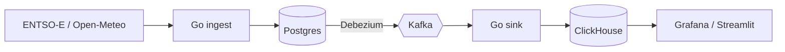

<p align="center">
  <a href="https://github.com/mishfish">
    
  </a>
</p>

```sql
mishfish=> SELECT * FROM engineer WHERE handle = 'mishfish';
```

```
 field     | value
-----------+------------------------------------------------------------
 name      | Mykhailo (Misha) Bohdanov
 role      | Software / Data Engineer @ AUTODOC
 location  | Odesa, Ukraine 🇺🇦
 daytime   | CDC pipelines, database tooling, Go services
(4 rows)
```

<p align="center">
  
</p>
<p align="center">
  
  
  
  
</p>

---

### ⚡ [energy-data-platform](https://github.com/mishfish/energy-data-platform)

Data platform for the European electricity market. ENTSO-E prices, load and generation + weather, streamed end to end with CDC. The point is the boring hard parts: delivery guarantees, observability, failure handling, runbooks, 30+ ADRs. Includes a fake ENTSO-E API with fault injection, so the whole stack runs locally without tokens.



### 💬 [igcrm](https://github.com/mishfish/igcrm)

Customer cards built automatically from Instagram Direct. Meta webhooks → Go → Postgres; after a pause in the chat an LLM fills in name, phone, city, Nova Poshta branch and sizes, and drafts an order when the customer confirms. Every change goes to review with a diff; Directus is the UI.

`Go` `Postgres` `Directus` `Caddy` `LLM`

---

<p align="center"><sub><code>-- exactly once is a lie, idempotency is not</code></sub></p>
